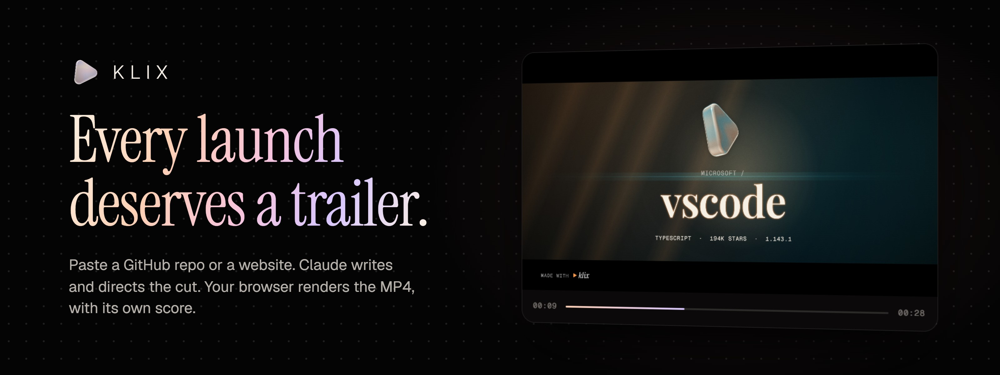
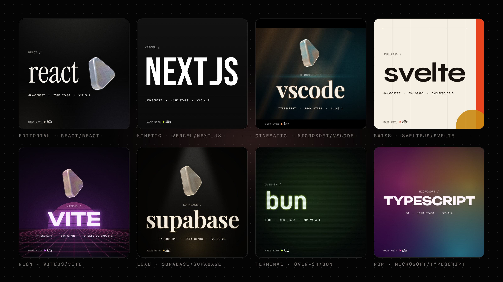
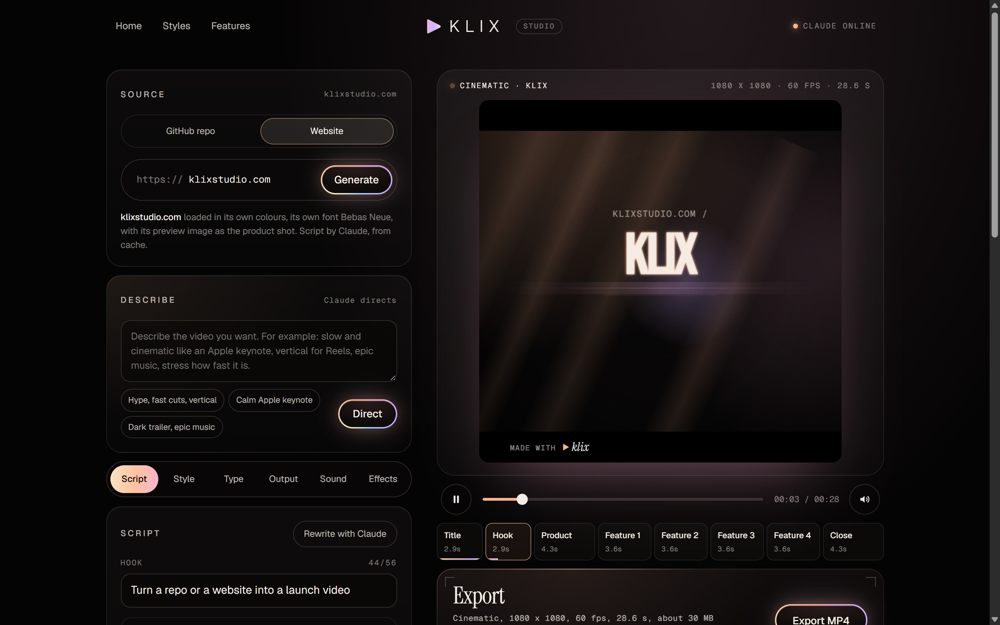
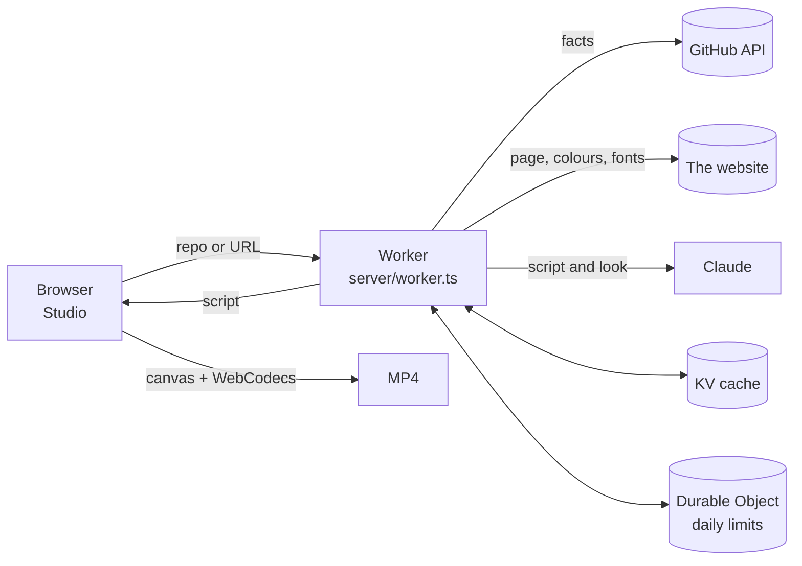

<p align="center">
  <a href="https://klixstudio.com"></a>
</p>

<p align="center">
  <a href="https://klixstudio.com"><b>klixstudio.com</b></a>
  &nbsp;&middot;&nbsp;
  <a href="https://klixstudio.com/make">Open the Studio</a>
  &nbsp;&middot;&nbsp;
  <a href="https://x.com/useklix">@useklix on X</a>
</p>

<p align="center">
  
  
  
  
</p>

<br />

Klix turns a GitHub repo or a website into a 20 to 30 second launch video, ready to post on X.

Paste a link. Klix reads the project, Claude writes the script and picks the look, and your browser renders an MP4 with its own original score. No sign up, no upload, no timeline editor.

<br />

## How it works

| | |
|---|---|
| **01&nbsp;&nbsp;Paste** | A public GitHub repo (`owner/repo`) or any public website. |
| **02&nbsp;&nbsp;Read** | Repos come in through the GitHub API: description, README, stars, release. Websites are read for their copy, colours, fonts and preview image. |
| **03&nbsp;&nbsp;Direct** | Claude writes the hook, the features and the close, and matches a style to the project. A website's video wears that website's own palette and type. |
| **04&nbsp;&nbsp;Render** | The browser draws every frame on a canvas, synthesizes the music, and encodes H.264 and AAC into an MP4 with WebCodecs. The video never leaves the machine. |
| **05&nbsp;&nbsp;Post** | Share to X in one tap on a phone, or download the file and post it with the text Klix wrote. |

<br />

## Sixteen styles



Every style sets its own type, motion, transitions, backdrop and music: Editorial, Cinematic, Kinetic, Minimal, Terminal, Glitch, Swiss, Neon, Luxe, Aurora, Brutalist, Pop, Blueprint, Film Noir, Mesh and Keynote. The frames above are real renders. The numbers on them come from GitHub, fetched on 2026-10-28.

<br />

## The Studio



- **Script.** Edit the hook, up to four features, the tagline and the call to action, or ask Claude to rewrite them.
- **Describe.** Say what you want in a sentence ("calm Apple keynote, vertical for Reels") and Claude sets every option.
- **Style and type.** 16 styles, 16 palettes plus a custom accent, 8 typefaces, or the website's own font.
- **Output.** Square, portrait, vertical or landscape. 720p to 4K. 60, 90 or 120 fps.
- **Sound.** Seven synthesized tracks with drops and hits that land on the cuts. Nothing to license.

<br />

## Architecture



| Path | What lives there |
|---|---|
| `web/` | Landing page and Studio. Vite, no framework. |
| `web/src/render.ts` | The renderer: styles, palettes, timeline and every frame. |
| `web/src/music.ts` | The score, rendered offline with Web Audio. |
| `web/src/encode.ts` | Frame-by-frame MP4 export with WebCodecs and mp4-muxer. |
| `server/api.ts` | The API, shared by the Node server and the Worker. |
| `server/worker.ts` | Cloudflare Workers host: static assets, KV cache, daily limits. |
| `server/index.ts` | Local Node host for development. |
| `server/site.ts` | Website reader, with an SSRF guard on every URL it fetches. |

<br />

## Run it locally

```bash
npm install
cp .env.example .env     # add ANTHROPIC_API_KEY; without it Klix runs in test mode
npm run dev              # web on http://localhost:5173, API on :8787
```

Without an API key, Klix builds scripts from the README with simple rules and the Studio says so.

## Deploy

Klix runs on the Cloudflare Workers free plan.

```bash
npx wrangler secret put ANTHROPIC_API_KEY
npx wrangler secret put GITHUB_TOKEN     # optional, raises the GitHub limit to 5000 requests an hour
npm run deploy
```

| Setting | Default | |
|---|---|---|
| `CLAUDE_MODEL` | `claude-opus-5-5` | Model that writes the scripts. |
| `CLAUDE_EFFORT` | `low` | Effort level for each call. |
| `SCRIPTS_PER_IP_PER_DAY` | `5` | New Claude scripts per visitor per day. Cached projects are free. |
| `CLAUDE_CALLS_PER_DAY` | `150` | Ceiling across all visitors, so the bill has a hard cap. |

<br />

## Notes

- The fast, exact export uses WebCodecs, tested in Chrome. Browsers without it fall back to a real-time recording.
- Code snippets in a video are copied from a code block in the README. Claude never writes them.
- Every video carries a small "made with klix" mark.

<br />

<p align="center">
  <a href="https://klixstudio.com"></a>
</p>
